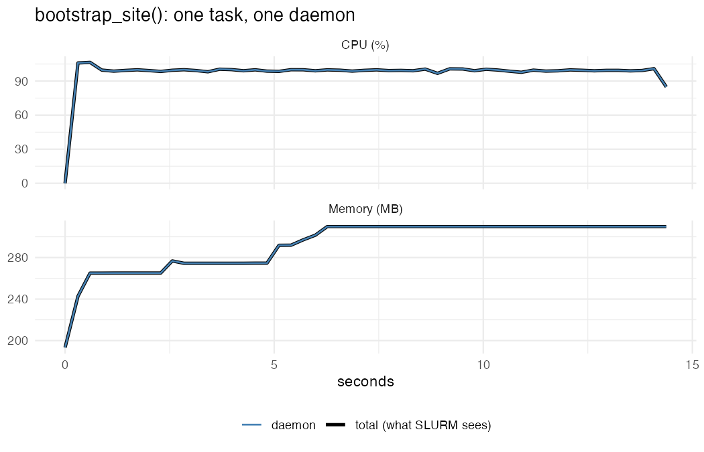
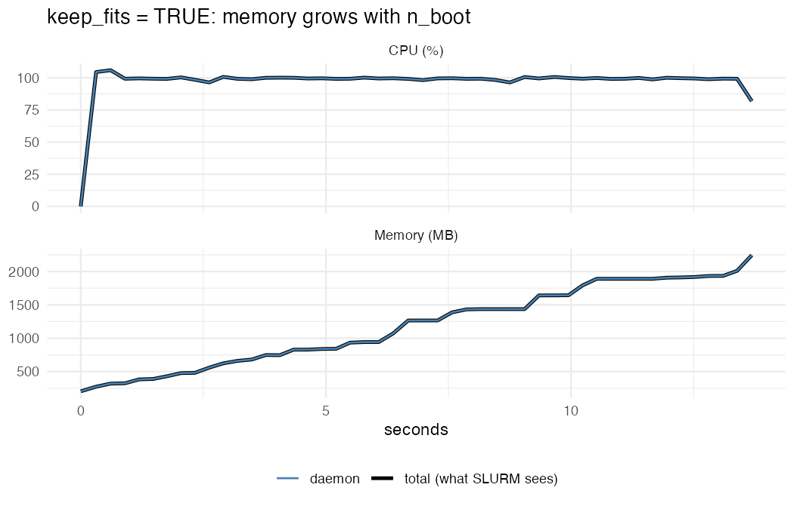
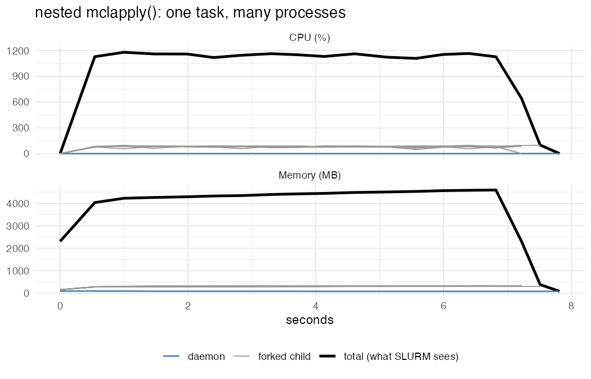
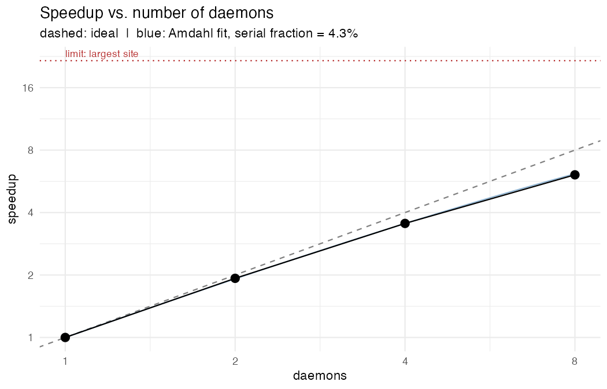
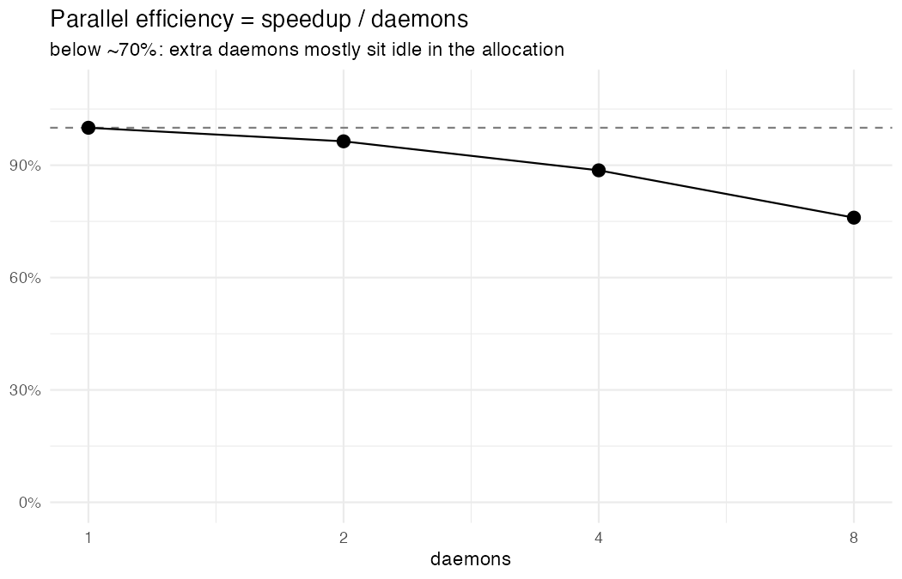

## Agenda (45 min)

| min | |
|---|---|
| 0–5 | The problem: per-site survival analysis that takes too long |
| 5–12 | mirai in 7 minutes |
| 12–30 | **Responsibility**: profile *one* task, derive the SLURM request |
| 30–38 | Launch right-sized daemons on SLURM, check with `sacct` |
| 38–43 | Scaling: 1, 2, 4, 8, … daemons |
| 43–45 | Checklist |

Code: `R/01_…` to `R/06_…` — run them in order in your Workbench session.

# The problem {background-color="#2c3e50"}

## A hospital group asks…

> Does the new treatment reduce the hazard of readmission-or-death — **at every site**?

- 40 hospital sites, 2,000–10,000 patients each, ~50 lab values per patient
- Per site: Cox model `Surv(time, event) ~ treatment + age + sex + comorbidity`
- Uncertainty: **5,000 bootstrap resamples per site**

```{r}
bootstrap_site <- function(site_df, n_boot = 1000) {
  formula <- survival::Surv(time, event) ~ treatment + age + sex + comorbidity
  log_hr <- vapply(seq_len(n_boot), function(b) {
    idx <- sample.int(nrow(site_df), replace = TRUE)
    stats::coef(survival::coxph(formula, data = site_df[idx, ]))[["treatmentnew"]]
  }, numeric(1))
  data.frame(site = site_df$site[1], hr = exp(median(log_hr)), ...)
}
```

`R/01_simulate_cohort.R`, `R/functions.R`

## On one core

```{r}
t_small <- system.time(bootstrap_site(one_site, n_boot = 1000))
# extrapolate to 40 sites x 5000 resamples
```

```
Estimated serial runtime: ~20 minutes (laptop) … hours on a bigger cohort
```

- 40 sites, each independent → **embarrassingly parallel**
- One task = one site

`R/02_serial_baseline.R`

# mirai in 7 minutes {background-color="#2c3e50"}

## Daemons + map

```{r}
library(mirai)
daemons(8)                                   # 8 persistent R workers

site_list <- split(cohort, cohort$site)      # one element per task
res <- mirai_map(site_list, bootstrap_site,
                 .args = list(n_boot = 5000))[.progress]

daemons(0)                                   # always clean up
```

- Daemons start **empty**: no packages, no globals → namespace-qualify (`survival::coxph`) or pass via `.args`
- Dispatcher hands tasks out FIFO as daemons become free
- `daemons(seed = 42)` → reproducible RNG regardless of how many daemons

## Same code, different place

```{r}
# laptop
daemons(8)

# SLURM: each daemon is one sbatch job that dials back to this session
daemons(8, url = host_url(), remote = cluster_config(
  command = "sbatch",
  options = "#SBATCH --mem=???\n#SBATCH --cpus-per-task=???\n#SBATCH --time=???"
))
```

The `mirai_map()` call does not change.

**But what goes into `???`**

# With great power comes great responsibility {background-color="#8e2c2c"}

## Why it matters

- `daemons(200, remote = cluster_config())` is one line — and 200 jobs in the queue
- Ask for **too much**: idle cores and RAM blocked for your colleagues, longer queue waits for *you* (the scheduler has to find bigger holes)
- Ask for **too little**: OOM-killed daemons, `TIMEOUT`, nodes oversubscribed
- Neither shows up as an R error you'd notice at once

**Rule: measure one task before you scale to N.**

## Profile one task, the way it will run

```{r}
profile_task <- function(fun, ..., interval = 0.1) {
  mirai::daemons(1, .compute = "profile")              # ONE fresh local daemon
  on.exit(mirai::daemons(0, .compute = "profile"))
  pid <- mirai::mirai(Sys.getpid(), .compute = "profile")[]
  res <- syrup::syrup(                                  # snapshot `ps` every 0.1s
    mirai::mirai(do.call(fun, args), .args = list(fun = fun, args = list(...)),
                 .compute = "profile")[],
    interval = interval)
  tidy_syrup(res, pid = pid)                            # keep daemon + its children
}

prof <- profile_task(bootstrap_site, site_df = largest_site, n_boot = 1000)
```

- Same code path as on the cluster (serialisation, fresh process, no globals)
- Profile the **largest** task — memory must fit the worst case
- [syrup](https://simonpcouch.github.io/syrup/) sees *all* R processes on the machine → filter by PID

`R/03_profile_one_task.R`

## The well-behaved task

{height=480}

~300 MB, a flat 100% CPU → **1 core, small memory**

## Gotcha 1: memory that grows with the work

```{r}
profile_task(bootstrap_site, site_df = largest_site, n_boot = 1000, keep_fits = TRUE)
```

{height=380}

Profiling with 1,000 resamples would **under-estimate** the 5,000 production run by 5×. Fix the code, don't just ask for more RAM.

## Gotcha 2: hidden parallelism

```{r}
bootstrap_site(..., n_cores = parallel::detectCores())   # a "helpful" colleague
```

{height=380}

`detectCores()` on a compute node = **all cores of the node**, not your allocation. 8 daemons × 64 forks.

## Gotcha 2: what to do

- CPU % well above 100 → the task uses more than one core
- Either request `--cpus-per-task=k` **and** respect it:
  ```{r}
  n_cores <- as.integer(Sys.getenv("SLURM_CPUS_PER_TASK", 1))
  # or parallelly::availableCores()
  ```
- Or, for embarrassingly parallel work: keep tasks single-threaded and let mirai parallelise
- Same story for multithreaded BLAS / OpenMP / data.table → set `OMP_NUM_THREADS`
- Caveat: forked children share memory pages — summing RSS over-counts

## Gotcha 3: shipping more than you need

```{r}
# whole cohort to every task, filter inside
mirai_map(site_ids, function(id) bootstrap_site(cohort[cohort$site == id, ]),
          .args = list(cohort = cohort))
```

| | serialised per task | peak RSS |
|---|---|---|
| whole cohort | ~90 MB | ~540 MB |
| one site (`split()` first) | ~4 MB | ~310 MB |

×40 tasks, over the network, held in every daemon.

## From measurements to `#SBATCH`

```{r}
p <- summarise_profile(prof_good)   # wall_s, peak_rss_mb, mean_cpu_pct, ...

resources <- list(
  cpus   = max(1, round(p$mean_cpu_pct / 100)),
  mem_mb = ceiling(p$peak_rss_mb * 1.5 / 256) * 256,          # 1.5x headroom
  time_s = task_s * ceiling(N_SITES / N_DAEMONS) * 2 + 300     # 2x + start-up
)
cat(slurm_options(resources, partition = "cpu"))
```

```
#SBATCH --job-name=mirai-coxboot
#SBATCH --partition=cpu
#SBATCH --cpus-per-task=1
#SBATCH --mem=512M
#SBATCH --time=0-00:15:36
#SBATCH --output=logs/%x-%j.out
export OMP_NUM_THREADS=$SLURM_CPUS_PER_TASK
```

Limits apply **per daemon** (one sbatch job each).

# Launching on SLURM {background-color="#2c3e50"}

## Right-sized daemons

```{r}
daemons(
  n        = 8,
  url      = host_url(),                       # compute nodes dial back here
  remote   = cluster_config(command = "sbatch",
                            options = slurm_options(resources, partition = "cpu"),
                            rscript = RSCRIPT),
  seed     = 42,
  idletime = 5 * 60 * 1000,                    # idle daemon exits -> frees allocation
  walltime = (resources$time_s - 120) * 1000   # stop before SLURM kills us
)
wait_for_daemons(8)                            # jobs may sit in the queue

res <- mirai_map(site_list, bootstrap_site, .args = list(n_boot = 5000))[.progress]
daemons(0)
```

- Sort tasks **largest first** → the big site doesn't finish last on its own
- Compute nodes need network access to the Workbench session and the same R packages

`R/04_launch_slurm.R`

## Alternative: the Workbench Launcher

```{r}
daemons(
  n      = 8,
  url    = host_url(),
  remote = http_config(cpus = resources$cpus, memory = resources$mem_mb),
  seed   = 42
)
```

- Workbench submits the jobs for you (admin-configured cluster / resource profiles)
- Same lesson: pass the **measured** `cpus` / `memory`, not the biggest profile

## Close the loop: requested vs. used

```bash
sacct --name=mirai-coxboot -S today -X --units=M \
      --format=JobID,State,ReqCPUS,ReqMem,Timelimit,Elapsed,TotalCPU
sacct --name=mirai-coxboot -S today --units=M --format=JobID,MaxRSS | grep batch
seff <jobid>
```

- `MaxRSS` ≪ `ReqMem` → lower `--mem` next time
- `TotalCPU` ≈ `Elapsed × ReqCPUS` → the cores were actually used
- `OUT_OF_MEMORY` / `TIMEOUT` → back to profiling

# Scaling {background-color="#2c3e50"}

## 1, 2, 4, 8, … daemons

```{r}
for (n in c(1, 2, 4, 8, 16, 32)) {
  start_daemons(n, resources, ...)                        # queue time measured separately
  t <- system.time(mirai_map(site_list, bootstrap_site, .args = list(n_boot = 1000))[])
  daemons(0)
}
```

`R/05_scaling.R`, `R/06_plot_scaling.R`

## Speedup

{height=480}

## Efficiency

{height=420}

- Granularity limit: 40 unequal tasks → never faster than the **largest site**
- Beyond ~70% efficiency loss, extra daemons are mostly idle allocations
- On a busy cluster, **queue time** for many jobs can outweigh the compute gain

# Wrap-up {background-color="#2c3e50"}

## Checklist before `daemons(n, remote = ...)`

1. **One task, one daemon, syrup** — profile the *largest* task
2. Memory flat? CPU ≈ 100%? If not: fix the code first
3. Ship only what each task needs (`split()` first)
4. Derive `--mem`, `--cpus-per-task`, `--time` with modest headroom
5. Use `idletime` / `walltime`, and `daemons(0)` when done
6. Check `sacct` / `seff` — then refine
7. Pick `n` from the scaling curve, not from "as many as possible"

## Resources

- mirai: <https://mirai.r-lib.org>
- syrup: <https://simonpcouch.github.io/syrup/>
- Workshop code: this repository, `R/01_…` – `R/06_…`
